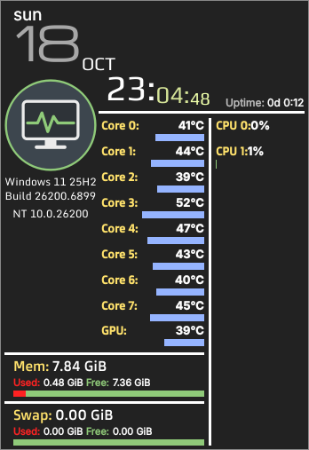
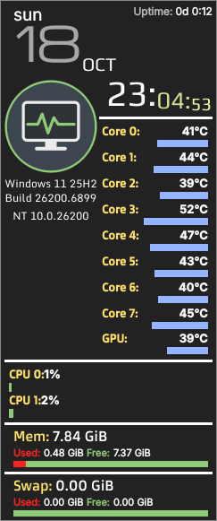
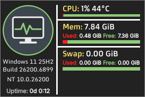

Simple Monitor Desktop
======================

*Deutsch weiter unten.*

The **Simple System Monitor** desktop widget – known from KDE Plasma – as a
standalone program for **Windows** (and other Linux desktops such as GNOME or Xfce):
date and time, logo, CPU load per core, CPU and GPU temperatures, memory, swap
and uptime. Three skins: Default, Column and Minimalistic.

| Default | Column | Minimalistic |
|---|---|---|
|  |  |  |

The look is shared with the KDE Plasma 6 widget
[plasma-simplemonitor6](https://github.com/krumbinet/plasma-simplemonitor6)
(on Plasma, use that one – it is a native widget). Both are based on
[plasma-simpleMonitor](https://github.com/dhabyx/plasma-simpleMonitor) by
Dhaby Xiloj and Konstantin Shtepa.

Status: **early version (0.1)** – feedback welcome!

Install on Windows
------------------

1. Download `SimpleMonitor-<version>-windows-x64.zip` from the
   [releases](https://github.com/krumbinet/simplemonitor-desktop/releases) and unzip it,
   e.g. to `C:\Users\<you>\SimpleMonitor`.
2. Start `SimpleMonitor.exe`. The program is not code-signed, so Windows SmartScreen
   may warn about an unknown publisher: *More info* → *Run anyway*.
3. **Right click** on the widget: settings, lock position, always on top,
   start with Windows, logo size, quit. **Drag** with the left mouse button to move it,
   **double click** opens the settings. The tray icon offers the same menu.

### CPU temperatures on Windows

Windows does not give normal programs access to CPU temperatures. Install
[LibreHardwareMonitor](https://github.com/LibreHardwareMonitor/LibreHardwareMonitor/releases)
(free, open source), start it **as administrator** and keep it running (it can
start minimized with Windows). Simple Monitor reads its sensors automatically
via WMI; OpenHardwareMonitor works as well. Without it, CPU temperatures are
simply hidden. **NVIDIA** GPU temperatures work without any extra tool.

Run on Linux / from source
--------------------------

```sh
git clone https://github.com/krumbinet/simplemonitor-desktop
cd simplemonitor-desktop
pip install -r requirements.txt polib
python3 tools/compile_translations.py
python3 -m simplemonitor
```

On Windows without building: `run-from-source.bat` (needs Python 3.10+).

Settings and log file
---------------------

- Windows: `%LOCALAPPDATA%\SimpleMonitor\` (`config.json`, `simplemonitor.log`)
- Linux: `~/.config/SimpleMonitor/`

If something does not work, the log file usually tells why – please attach it to an
[issue](https://github.com/krumbinet/simplemonitor-desktop/issues).

Known limitations
-----------------

- With "transparent" background, the widget can only be grabbed on its visible
  parts (hover shows a frame). Use "translucent" for easy handling.
- *Win+D* ("show desktop") may hide the widget like other windows.
- No code signing yet (SmartScreen warning).

Development
-----------

```
simplemonitor/            Python package
  app.py                  start-up, window, tray/menu, settings window
  systemdata.py           sensor values for QML ("sysData") – same API as SystemData.qml of the Plasma widget
  sources/temperatures.py LibreHardwareMonitor (WMI), hwmon (psutil), NVIDIA (NVML)
  config.py               settings (JSON) exposed to QML as "cfg"
  qml/contents/           skins, widgets, fonts, images – shared with the Plasma widget
  qml/contents/ui/desktop Widget.qml (window), Settings.qml
  qml/compat/             tiny stand-in for Kirigami.Icon
po/                       translations (same strings as the Plasma widget + desktop strings)
packaging/                PyInstaller spec, icon, Windows build script
tools/                    sync from the Plasma widget, translations, screenshots
.github/workflows/        builds the Windows .zip on every push, attaches it to releases
```

- Shared QML: `python3 tools/sync_from_plasma.py ../plasma-simplemonitor6` copies skins,
  widgets, fonts and images from the Plasma widget. Please change shared files there first.
- Translations: `tools/update_translations.sh` (needs gettext), then edit `po/<lang>.po`,
  then `python3 tools/compile_translations.py`.
- Tests: `python3 tests/test_temperatures.py`;
  screenshots with fake Windows data: `QT_QPA_PLATFORM=offscreen python3 tools/preview.py /tmp/shot 0`.
- Windows build: push to GitHub (Actions builds it) or run `packaging\build-windows.bat`.

License
-------

GNU General Public License version 3 or later, see [COPYING](COPYING).
Qt for Python (PySide6): LGPL-3.0. Fonts: SIL Open Font License (see `qml/contents/fonts/*/OFL.txt`).
Distribution logos are trademarks of their respective owners. See [AUTHORS.md](AUTHORS.md).

---

Deutsch
=======

Das Desktop-Widget **Simple System Monitor** aus KDE Plasma als eigenständiges
Programm für **Windows** (und andere Linux-Oberflächen wie GNOME oder Xfce):
Datum und Uhrzeit, Logo, CPU-Last pro Kern, CPU- und GPU-Temperaturen,
Arbeitsspeicher, Auslagerungsspeicher und Laufzeit. Drei Skins: Standard,
Spalte und Minimalistisch.

Das Aussehen ist identisch mit dem Plasma-6-Widget
[plasma-simplemonitor6](https://github.com/krumbinet/plasma-simplemonitor6) – unter
KDE Plasma bitte das verwenden.

Stand: **frühe Version (0.1)** – Rückmeldungen sind willkommen!

Installation unter Windows
--------------------------

1. `SimpleMonitor-<Version>-windows-x64.zip` aus den
   [Releases](https://github.com/krumbinet/simplemonitor-desktop/releases) laden und entpacken,
   z. B. nach `C:\Users\<Name>\SimpleMonitor`.
2. `SimpleMonitor.exe` starten. Das Programm ist nicht signiert, daher kann Windows
   SmartScreen vor einem unbekannten Herausgeber warnen: *Weitere Informationen* →
   *Trotzdem ausführen*.
3. **Rechtsklick** auf das Widget: Einstellungen, Position fixieren, immer im
   Vordergrund, beim Systemstart öffnen, Logo-Größe, Beenden. Mit der linken
   Maustaste **ziehen** zum Verschieben, **Doppelklick** öffnet die Einstellungen.
   Das Symbol im Infobereich der Taskleiste bietet dasselbe Menü.

### CPU-Temperaturen unter Windows

Windows gibt normalen Programmen keinen Zugriff auf CPU-Temperaturen. Dafür
[LibreHardwareMonitor](https://github.com/LibreHardwareMonitor/LibreHardwareMonitor/releases)
(kostenlos, Open Source) installieren, **als Administrator** starten und laufen
lassen (es kann minimiert mit Windows starten). Simple Monitor liest die Werte dann
automatisch. Ohne das Programm werden die CPU-Temperaturen ausgeblendet.
**NVIDIA**-Grafikkarten funktionieren auch ohne.

Einstellungen und Protokoll
---------------------------

Windows: `%LOCALAPPDATA%\SimpleMonitor\`, Linux: `~/.config/SimpleMonitor/`.
Bei Problemen bitte die Datei `simplemonitor.log` an ein
[Issue](https://github.com/krumbinet/simplemonitor-desktop/issues) anhängen.

Lizenz
------

GNU General Public License Version 3 oder neuer, siehe [COPYING](COPYING).
